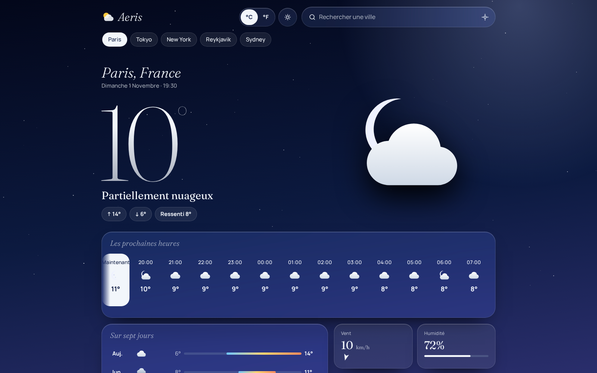
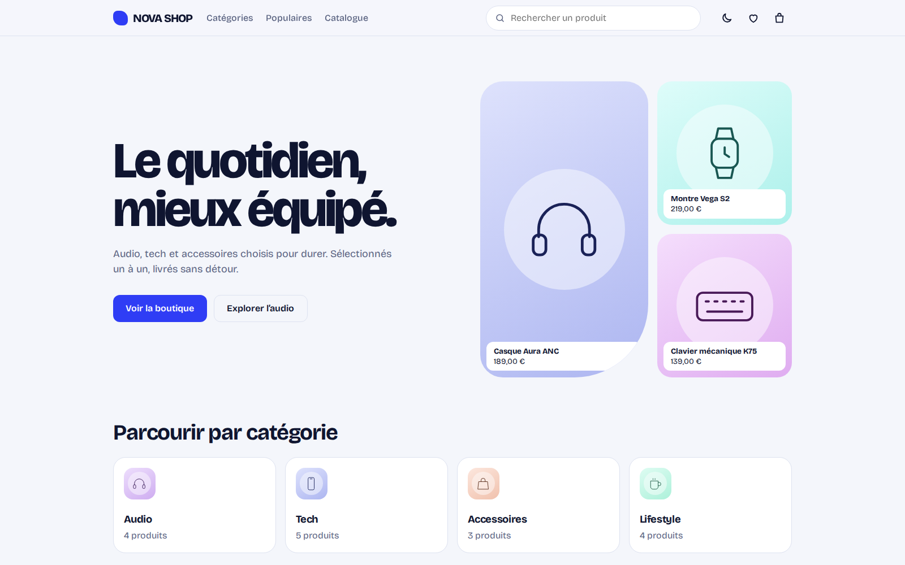
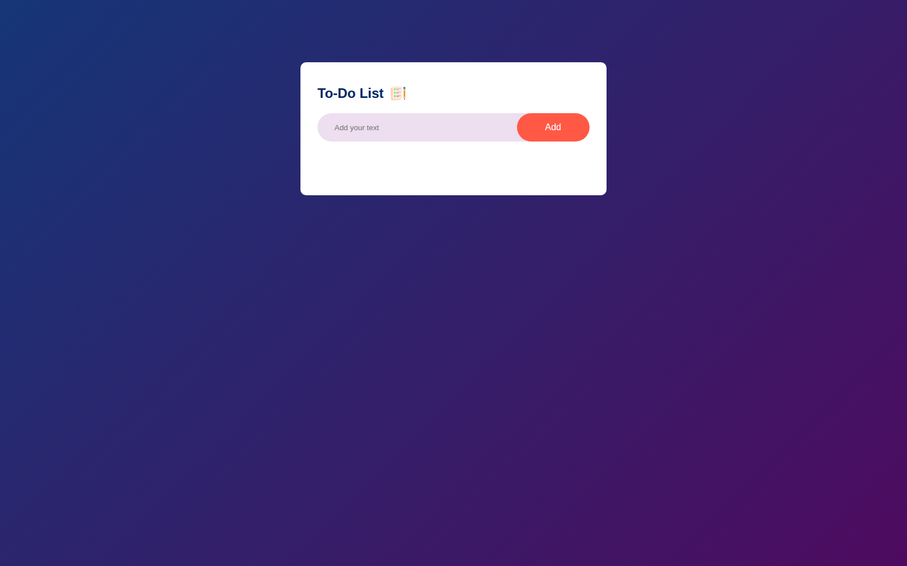
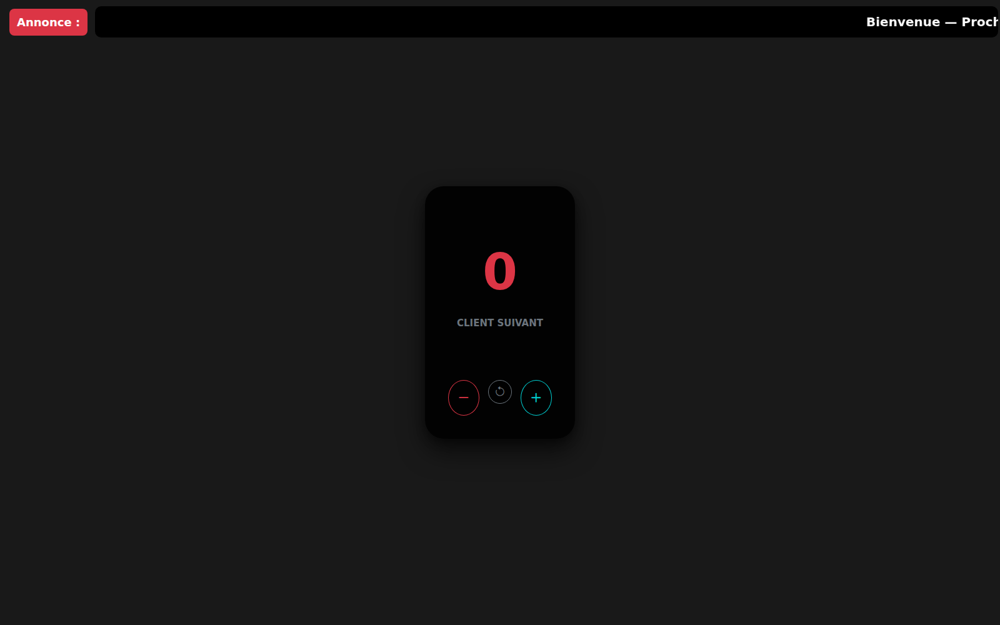
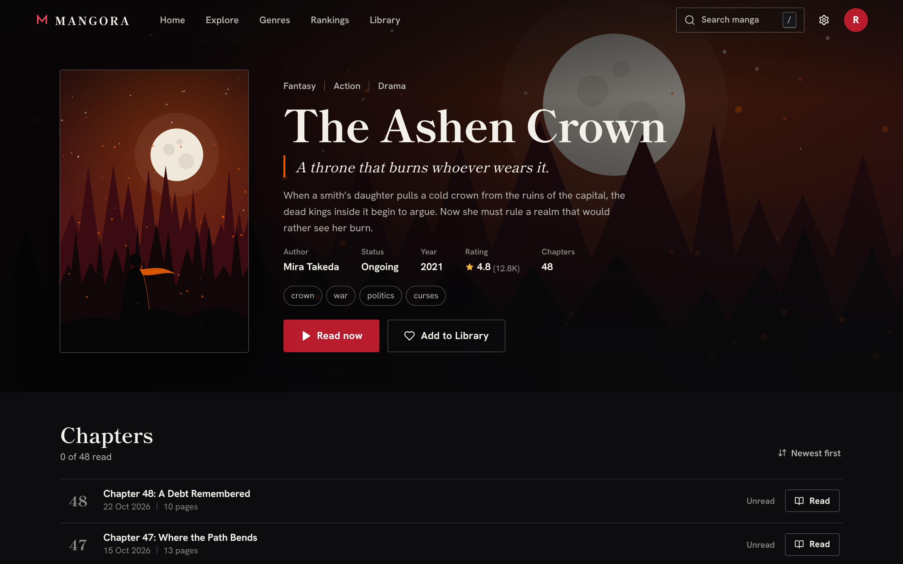

# NOOR DIGITAL — Portfolio

> **La lumière qui structure.**
> Portfolio of a Full Stack Web Developer (PHP • Laravel • JavaScript), based in Dakar, Senegal.

**Live site (once deployed):** <https://noor-digital.github.io/noor-digital-portfolio/>

## Project gallery — real application captures

The following images are real screenshots captured from the running project demos (1600 × 1000).

<table>
<tr>
<td width="50%"><a href="https://noor-digital.github.io/aeris-meteo/"></a><strong>Aeris Météo</strong></td>
<td width="50%"><a href="https://noor-digital.github.io/nova-shop/"></a><strong>NOVA SHOP</strong></td>
</tr>
<tr>
<td width="50%"><a href="https://sabaly-consulting-green.vercel.app/"></a><strong>Sabaly Consulting</strong></td>
<td width="50%"><a href="https://to-do-list-sigma-woad-32.vercel.app/"></a><strong>To-Do List</strong></td>
</tr>
<tr>
<td width="50%"><a href="https://vocal-queue-system.vercel.app/"></a><strong>Vocal Queue System</strong></td>
<td width="50%"><a href="https://noor-digital.github.io/mangora/"></a><strong>MANGORA</strong></td>
</tr>
</table>
---

## Overview

NOOR DIGITAL is a five-page portfolio built as a single cohesive React application. It presents the developer's projects, services and working method with an editorial, typography-led design.

*Noor* means light. *Digital* stands for structure, logic and construction. The identity is built on that idea: light is never shown as a glow, but as a fine line that reveals the structure of the site.

## Art direction — "Le tracé"

Three motifs run through the whole interface.

| Motif | What it is | Where it appears |
|---|---|---|
| **Le tracé** (the trace) | A 1 px amber line that draws itself progressively | Section separators, link underlines, active navigation, project rows, page transitions |
| **Le rayon** (the ray) | A single 1 px vertical line, solid amber. It hangs from the hairline under the identity row, passes through the word spaces of the title ("La \| lumière", "qui \| structure") without touching a letter, and ends in a small dot on the baseline of "structure". Its position is expressed in `em`, so it follows the title size at every screen width | Home hero only |
| **L'index** (the index) | Monospaced numbering `01 — 05` and a live clock for the `Africa/Dakar` time zone (`DAKAR — 12:34:56`) | Navigation, page heads, projects, services, hero, contact and footer. Not used as a counter on every section |

Amber (`#E9B44C`) is the only accent colour and covers a very small part of the surface. There are no glows, coloured shadows or large gradients.

### Palette

All colours are CSS variables in [`src/styles/tokens.css`](src/styles/tokens.css).

| Role | Value |
|---|---|
| Charcoal 0 — deep: hero, page heads, mobile menu, footer | `#0E0F11` |
| Charcoal 1 — surface: main sections (studio, technologies, projects page, services, contact) | `#141518` |
| Charcoal 2 — matter: project plates, closing block, opened service | `#1B1C20` |
| Charcoal 3 — relief: large plate numerals, hover on matter | `#24262B` |

Surfaces are applied with `.surface--0` … `.surface--2` (see `src/styles/layout.css`). Each class redefines `--surface` and `--surface-up`, so hover and open states automatically lift by one level wherever they sit.
| Ivory — primary text | `#ECE6DA` |
| Stone — secondary text | `#B5B0A5` |
| Mist — metadata | `#8A867D` |
| Light — accent | `#E9B44C` |

### Typography

Self-hosted through [Fontsource](https://fontsource.org/) (no request to Google Fonts):

- **Instrument Serif** — large titles and editorial expressions
- **Hanken Grotesk** — body text and interface
- **JetBrains Mono** — indexes, metadata, technical labels

## Page d’accueil (V4 — « manga cinématique »)

L’accueil est une scène illustrée sur mesure : un développeur de dos, sur un toit, lève la lumière qui devient le point de fuite de toute la composition (« La lumière qui structure »). Les autres pages gardent leur direction artistique d’origine (ambre et anthracite).

**Récit, de haut en bas** : Hero (cinématique, épinglé) → Présentation en cases de manga → Services (zone calme, onglets) → Projets (bande horizontale) → Méthode (le rayon descend) → Technologies (zone calme) → Contact (l’aube) → pied de page.

- **Code** : `src/pages/Home.jsx` assemble `src/components/home/` (`Hero`, `HeroScene`, `Approach`, `HomeServices`, `HomeProjects`, `Method`, `ContactScene`, `HomeFooter`, `HomeMenu`, `Cta`, `TitleReveal`, `ScrollRail`). Les illustrations vectorielles sont dans `src/components/home/art/` (`Character`, `SceneLayers`, `PanelArt`, `ServiceArt`, `ProjectArt`, `world.js`). Styles : `src/styles/home.css` (tous les sélecteurs sont préfixés `nh-`, `sc-`, `ch-`… ; aucune règle ne touche les autres pages).
- **Aucune ressource externe** : le personnage, les décors et toutes les illustrations sont dessinés en SVG pour ce projet (aucune photo, aucune image téléchargée, aucune licence à gérer). Les anciennes photos de `public/assets/` ne sont plus utilisées par l’accueil.
- **Contenu** : textes de l’accueil dans l’export `home` de `src/data/site.js` ; services, méthode, projets et technologies sont lus directement dans `services.js`, `projects.js` et `skills.js` (un seul endroit à modifier).
- **Projets** : aucune capture n’est inventée. Tant que le champ `image` d’un projet vaut `null`, une illustration originale évoque le projet (motifs dans `ProjectArt.jsx`, indexés par `slug` ; un projet sans motif reçoit une grande initiale). Dès qu’une capture est renseignée, elle remplace l’illustration ; supprimez alors `home.projects.note`.
- **Animation** : parallaxe du pointeur à 8 profondeurs, entrée cinématique du Hero, zoom vers la lumière au défilement, cases révélées par un rideau d’encre, bande de projets horizontale pilotée par le défilement (défilement natif, jamais détourné), rayon de la méthode, indicateur d’avancement. Seuls `transform` et `opacity` sont animés. Les animations d’ambiance (manteau, écharpe, cheveux, poussière) sont en CSS.
- **Mouvement réduit** (`prefers-reduced-motion`) : scène immobile et complète, plus d’épinglage, de rideaux ni de zoom ; les projets deviennent un rail horizontal à faire glisser.
- **Responsive** : deux cadrages de la scène (paysage / portrait) ; la bande de projets n’est épinglée qu’à partir de 960 px de large et 540 px de haut (sinon rail à glisser avec accroche) ; le Hero n’est pas épinglé sur les écrans de moins de 600 px de haut.
- **Typographie** : Archivo (variable, axes graisse et largeur) pour les titres condensés, Zen Kaku Gothic New pour le texte, via Fontsource.
- **Réseaux** : seuls les liens renseignés dans `site.js` (GitHub, e-mail, et LinkedIn/WhatsApp si fournis) apparaissent dans la section contact.

## Page À propos (direction manga)

`/a-propos` suit la même direction artistique que l’accueil : tête avec le nom en grand et le gros plan du personnage (le cadre se resserre au défilement), planche de trois cases (présentation et fiche), parcours en deux cases, quatre principes avec un glyphe dessiné chacun, puis une clôture avec deux actions réelles (contact, projets).

- **Code** : `src/pages/About.jsx` assemble `src/components/about/` (`AboutHead`, `ProfileBoard`, `Journey`, `Principles`, `AboutClose`) ; styles dans `src/styles/about.css` (préfixe `nh-ab-`). Les briques communes viennent de `components/home/` (`Panel`, `TitleReveal`, `Cta`, illustrations).
- **Contenu** : `profile`, `journey` et `principles` de `src/data/site.js` (inchangés), plus l’export `aboutPage` pour les titres. Aucun fait ajouté, aucun portrait inventé (le monogramme tient lieu d’identité visuelle).
- **Adapter une autre page** : ajoutez son chemin dans `src/lib/mangaRoutes.js` ; l’en-tête, le menu mobile et le pied de page passent alors automatiquement en variante manga pour cette page. Tant qu’un chemin n’y figure pas, la page garde la direction d’origine (ambre et anthracite).

## Page Projets (direction manga)

`/projets` : tête avec une planche-contact des projets (chaque vignette est un lien d’accès rapide), filtres par catégorie, puis une double-page par projet (illustration ou capture dans une case, fiche dans une seconde case qui la chevauche, grand numéro en filigrane), et une clôture.

- **Code** : `src/pages/Projects.jsx` assemble `src/components/projects/` (`ProjectsHead`, `ProjectFilterBar`, `ProjectSpread`) et `components/home/PageClose.jsx` ; styles dans `src/styles/projects.css` (préfixe `nh-pj-`). Les illustrations sont celles de l’accueil (`ProjectArt.jsx`).
- **Données** : `src/data/projects.js` (inchangé) ; textes de la page dans l’export `projectsPage` de `site.js`. Un nouveau projet apparaît tout seul (planche-contact, filtres, double-page) ; sans motif dédié dans `ProjectArt.jsx` il reçoit une grande initiale, et dès que son champ `image` est renseigné la capture remplace l’illustration.
- **Comportements conservés** : filtres avec compteurs (`aria-pressed`, message d’état en direct), ancres `/projets#slug` (utilisées par l’accueil), liens GitHub et démo, statut déduit des données (jamais inventé).
- **Ancres** : `ScrollManager` garde désormais la cible alignée pendant 2 secondes après un défilement vers une ancre (les polices et images changent la hauteur de la page après coup), sauf si le visiteur a déjà bougé. Cela profite à toutes les pages.

## Page Services (direction manga)

`/services` : tête avec une planche des quatre services (chaque vignette est un lien d’accès rapide), puis une double-page par service (la scène dessinée dans une case, la fiche dans une seconde case qui la chevauche : description, livrables, action « Parler de ce service »), la méthode en quatre étapes (le rayon descend avec le défilement) et une clôture.

- **Code** : `src/pages/Services.jsx` assemble `src/components/services/` (`ServicesHead`, `ServiceSpread`, `ServicesProcess`) et `components/home/PageClose.jsx` ; styles dans `src/styles/services.css` (préfixe `nh-sv-`). Les scènes sont celles de l’accueil (`ServiceArt.jsx`) ; `ServicesProcess` réutilise l’étape `Step` de `Method.jsx` (exportée pour l’occasion).
- **Données** : `src/data/services.js` (inchangé : services, livrables, méthode) ; textes de la page dans l’export `servicesPage` de `site.js`. Un nouveau service apparaît tout seul (planche, double-page) ; sans scène dédiée dans `ServiceArt.jsx` il reçoit la scène « sites web » par défaut.
- **Changement de comportement** : l’ancien accordéon est remplacé. Les livrables sont désormais toujours visibles (rien n’est replié), et chaque scène se dessine à son arrivée à l’écran.
- **Ancres** : chaque service a un `id` (`/services#sites-web`, etc.), conservé par `ScrollManager`.

## Page Contact (direction manga)

`/contact` : tête avec la grande phrase et une **fiche à remplir** (nom, type de projet pris dans la liste des services, description, échéance), puis les autres canaux en cases (e-mail avec « Copier l’adresse », GitHub, LinkedIn/WhatsApp s’ils sont renseignés, localisation avec l’heure de Dakar) et une clôture vers les projets et les services.

- **Code** : `src/pages/Contact.jsx` assemble `src/components/contact/` (`ContactHead`, `ContactForm`, `ContactCards`) et `components/home/PageClose.jsx` ; styles dans `src/styles/contact.css` (préfixe `nh-ct-`).
- **Honnêteté du formulaire** : le site est statique, sans backend. La fiche **prépare un e-mail** (lien `mailto:` rempli avec ce que le visiteur a saisi) et le dit clairement ; elle n’envoie rien et ne simule aucun envoi. Si aucune messagerie ne s’ouvre, le message reste affiché et copiable, avec l’adresse et l’objet.
- **Validation** : nom et description (10 caractères minimum) obligatoires, messages d’erreur en texte (jamais la couleur seule), focus placé sur le premier champ en erreur, `aria-invalid` / `aria-describedby`.
- **Contenu** : textes dans l’export `contactPage` de `site.js` (et `contactCopy` pour l’objet du message) ; canaux lus dans `site` (un canal à `null` reste masqué). Aucune coordonnée n’est inventée.
- **Dynamisme** : une enveloppe dessinée au trait (`ContactArt.jsx`) réagit à la fiche en direct : la lettre sort de l’enveloppe et se couvre de lignes au fil de la frappe, les rayons se dessinent avec l’avancement, un tampon se pose quand l’e-mail est prêt, et le pointeur déplace les plans en sens inverse. La fiche affiche une barre d’avancement (champs obligatoires remplis), un compteur de caractères, une barre oblique qui s’ouvre devant le champ actif, et l’aperçu « e-mail prêt » s’ouvre en douceur (il disparaît dès qu’on modifie un champ). Les cases de canaux s’inclinent de quelques degrés au pointeur (souris uniquement), « Copier l’adresse » confirme sur le bouton, et la case Localisation montre un arc de lumière qui suit l’heure de Dakar (repère indicatif de 7 h à 19 h).
- **Mouvement réduit** : avec `prefers-reduced-motion`, l’enveloppe se met à jour sans animation, les repères ne flottent plus, et les cases ne s’inclinent pas.
- Toutes les pages principales sont désormais en direction manga ; seule la page 404 garde l’ancienne.

## Features

- Five pages with their own URLs: `/`, `/a-propos`, `/projets`, `/services`, `/contact` (plus a 404 page)
- Signature page transition (exit → amber sweep → enter → title reveal), about 650 ms
- Hiding header on scroll down / reappearing on scroll up, with thresholds to avoid flicker
- Full-screen mobile menu (below 900 px): focus trap, `Esc` to close, scroll lock, focus returned to the "Menu" button
- Projects page with working category filters built from the data, animated reordering
- Services page as manga spreads (one per service, deliverables always visible, quick-access sheet) with the process beam drawn on scroll
- Live clock for Dakar using `Intl.DateTimeFormat` — a single shared timer for all clocks
- Contact through a real `mailto:` link prepared from a short form (no fake sending), with a "copy address" button and visible success/error messages
- Page title and meta description updated on every route; focus moved to the page heading after navigation; skip link; scroll reset on new navigation and restored on Back
- `prefers-reduced-motion` support: transitions become quick fades, the ray stops moving
- No backend, no database, no tracking

## Tech stack

- [React](https://react.dev/) 19 and [Vite](https://vite.dev/) 8
- [React Router](https://reactrouter.com/) 7
- [Motion for React](https://motion.dev/) (imported from `motion/react`)
- Custom CSS (no Bootstrap, no Tailwind, no template)
- [Fontsource](https://fontsource.org/) for fonts
- GitHub Actions + GitHub Pages for deployment

## Project structure

```text
noor-digital-portfolio/
├── public/                 # favicon, static assets (screenshots go in public/assets/)
├── src/
│   ├── main.jsx            # entry point, router, fonts, styles
│   ├── App.jsx
│   ├── data/               # ← editable content (no React knowledge required)
│   │   ├── site.js         #   identity, routes, texts, contact channels
│   │   ├── projects.js     #   the six projects
│   │   ├── services.js     #   services and working method
│   │   └── skills.js       #   technologies by group
│   ├── pages/              # Home, About, Projects, Services, Contact, NotFound
│   ├── layout/             # Header, MobileMenu, Footer, AnimatedRoutes, ScrollManager
│   ├── components/         # Button, TextLink, Hairline, Reveal, ProjectRow, …
│   ├── hooks/              # useDocumentTitle, useBodyLock, useMediaQuery
│   ├── lib/                # motion.js, prng.js, mangaRoutes.js
│   ├── lib/motion.js       # shared easing curves
│   └── styles/             # tokens, reset, base, typography, layout, components, pages
├── scripts/postbuild.js    # generates one HTML file per route + 404.html + sitemap
├── .github/workflows/deploy.yml
├── vite.config.js
└── package.json
```

## Getting started

**Requirements:** Node.js 20.19 or newer (developed with Node.js 22; the workflow uses Node.js 24) and npm.

```bash
# 1. Install dependencies (once)
npm install

# 2. Start the development server → http://localhost:5173/
npm run dev

# 3. Build for production (creates the dist/ folder)
npm run build

# 4. Preview the production build → http://localhost:4173/noor-digital-portfolio/
npm run preview   # serves the built site under /noor-digital-portfolio/ (same base as GitHub Pages)
```

In development the site is served from `/`. In the production build it is served from `/noor-digital-portfolio/`, which is the GitHub Pages sub-path.

## Customising the content

Everything editable lives in `src/data/`:

| I want to… | Edit |
|---|---|
| Change my texts, e-mail, GitHub link, page titles | `src/data/site.js` |
| Add or edit a project | `src/data/projects.js` |
| Add a demo link to a project | set `demo: 'https://…'` (leave `null` until the demo is verified) |
| Add a real screenshot to a project | put the file in `public/assets/`, then set `image: { src: 'assets/name.png', alt: '…', width: 1600, height: 1000 }` |
| Edit services and the working method | `src/data/services.js` |
| Edit technologies | `src/data/skills.js` |
| Show LinkedIn or WhatsApp on the Contact page | fill `linkedin` / `whatsapp` in `src/data/site.js` (they stay hidden while `null`) |

Unknown project fields (`year`, `demo`, `image`) are `null` and are simply not displayed. Projects without a screenshot show a typographic preview labelled "Aperçu à venir" — it is never presented as a capture of the application.

## Deployment on GitHub Pages

The target repository is `noor-digital/noor-digital-portfolio`.

```bash
# In the project folder
git init -b main
git add .
git commit -m "Initial commit"
git remote add origin https://github.com/noor-digital/noor-digital-portfolio.git
git push -u origin main
```

Then, once, on GitHub: **Settings → Pages → Build and deployment → Source: GitHub Actions**.

Every push to `main` runs [`deploy.yml`](.github/workflows/deploy.yml): checkout → Node.js → `npm ci` → `npm run build` → publish `dist/`. No secret is needed. The site is then available at <https://noor-digital.github.io/noor-digital-portfolio/>.

If you rename the repository, update `REPO_BASE` in `vite.config.js` and `siteUrl` in `src/data/site.js`.

### How direct URLs work on GitHub Pages

GitHub Pages does not rewrite unknown URLs to `index.html`, so a plain single-page app would return a 404 when you open or refresh `/projets`. To avoid this, `scripts/postbuild.js` runs after the build and:

1. writes one HTML file per route (`dist/projets/index.html`, `dist/contact/index.html`, …) with the correct `<title>`, description and canonical URL, so each route is a real static page that boots the app;
2. writes `dist/404.html`, which GitHub Pages serves for any unknown URL (the app then shows its own "Page introuvable" screen);
3. writes `sitemap.xml` and `robots.txt`;
4. fails the build if one of these files or titles is missing.

The trade-off: the page content itself is still rendered by JavaScript (there is no server-side pre-rendering), only the metadata is static.

## Accessibility notes

- Semantic landmarks (`header`, `nav`, `main`, `footer`), a skip link and visible focus states
- Page heading receives focus after each navigation
- Menu, filters and quick-access links are operable with keyboard and touch
- External links announce that they open in a new tab
- `prefers-reduced-motion` is respected

## Known limitations

- **No automated tests** are included in this repository.
- **No Lighthouse or accessibility audit results** are provided; run them yourself on the deployed site before quoting any score.
- **No demo links and no screenshots** are set for the six projects yet (the demo URLs could not be verified when the portfolio was built). Add them as described above.
- **No project year** is displayed, because the dates are not confirmed.
- The contact page relies on a `mailto:` link: it opens the visitor's e-mail application. There is no contact form, since the site is static and has no backend.
- Content is rendered client-side; only titles and descriptions are static per route.
- The JavaScript bundle is about 160 kB gzipped (React, React Router, Motion and the home page illustrations).
- All five main pages now use the manga direction (blue night / turquoise); only the 404 page keeps the original amber / charcoal one. 
- Technologies are listed by category in `src/data/skills.js` (brand icons via Simple Icons / Devicon, see `components/home/techIcons.jsx`).

## License

Source code and content © NOOR DIGITAL. License to be defined by the owner.

## Page Services (refonte, étape 2)

- Composants : `src/components/services/` (ServicesHero, ServicesStack, ServiceCard, WhyMe, ServicesProcess, WorkTypes, AfterContact, Faq, Testimonials, FloatingCta…). Styles : `src/styles/services.css` (préfixe `nh-sv-`).
- Textes : `servicesPage` dans `src/data/site.js`. Services, technologies et méthode : `src/data/services.js`. Témoignages : `src/data/testimonials.js` (section masquée tant que la liste est vide).
- Aucune mention financière sur la page (cartes, FAQ, méta, données structurées).
- Les boutons « Discuter de ce service » mènent à `/contact?service=<id>` : le formulaire pré-sélectionne le service.
- Données structurées (JSON-LD, sans champ financier) injectées dans `dist/services/index.html` par `scripts/postbuild.js`.

## Page Contact (refonte, étape 3)

- Composants : `src/components/contact/` (ContactHero, QuickActions, ContactWizard + StepService / StepProject / StepDetails / SuccessState / FallbackState, ReassurancePanel, FormSection, WhereWhen, ContactFaq, ContactTestimonials, OtherChannels, ContactFloatingCta). Styles : `src/styles/contact.css` (préfixe `nh-ct-`).
- Textes : `contactPage` dans `src/data/site.js`. Canaux et engagements : objet `site` (un champ à `null` reste masqué : `whatsapp`, `linkedin`, `availability`, `responseTime`). Témoignages : `src/data/testimonials.js` (section masquée tant que la liste est vide).
- Le formulaire accepte `/contact?service=<id>` (boutons de la page Services) et pré-coche le besoin.
- Aucune mention financière sur la page.

### Formulaire de contact : envoi réel sans backend

Le site est statique (GitHub Pages) : l'envoi passe par un service de formulaires.

1. **Formspree (recommandé).** Créez un compte gratuit sur formspree.io, cliquez sur « New form », donnez votre adresse e-mail de réception, puis copiez l'URL du formulaire (`https://formspree.io/f/xxxxxxxx`). Confirmez l'e-mail de validation que Formspree envoie.
2. **Web3Forms (alternative).** Sur web3forms.com, saisissez votre e-mail pour recevoir une clé d'accès publique. L'endpoint est `https://api.web3forms.com/submit` et la clé va dans `VITE_FORM_ACCESS_KEY`.
3. **En local :** copiez `.env.example` en `.env.local` et renseignez `VITE_FORM_ENDPOINT` (puis relancez `npm run dev`).
4. **En production (GitHub Pages) :** dans le dépôt, *Settings → Secrets and variables → Actions → onglet **Variables** → New repository variable* : créez `VITE_FORM_ENDPOINT` (et `VITE_FORM_ACCESS_KEY` pour Web3Forms). Le workflow `.github/workflows` les lit au build. Relancez ensuite le déploiement (push ou « Run workflow »).

Ces valeurs sont **publiques par nature** (elles finissent dans le JavaScript du site) : elles ne permettent que d'envoyer un message vers votre boîte. Ne mettez jamais de secret dans une variable `VITE_*`. Sans endpoint, ou si l'envoi échoue, le formulaire le dit clairement et propose « Ouvrir ma messagerie » (mailto prérempli) et « Copier le message » : il n'affiche « Message envoyé » que si le service a confirmé la réception.

## Page Projets (refonte, étape 4)

- Composants : `src/components/projects/` (ProjectsHero, ShowReel, StatsStrip, TechMarquee, ProjectToolbar, FeaturedProject, ProjectCard, ProjectList, ProjectDrawer, ProjectMedia, TechBadges, EmptyState, HowIWork, ProjectsFloatingCta). Styles : `src/styles/projects.css` (préfixe `nh-pj-`).
- Données : `src/data/projects.js`. Champs optionnels (masqués s'ils sont vides) : `featured`, `longDescription`, `features`, `learnings`, `role`, `year`, `demo`, `image`, `gallery`. Textes : `projectsPage` dans `src/data/site.js`.
- Un clic sur « Voir le projet » ouvre la fiche, synchronisée avec le hash : `/projets#slug` (l'accueil utilise déjà ces liens). Les filtres sont dans l'URL : `?cat=`, `?tech=`, `?q=`.
- Tant qu'un projet n'a pas de vraie capture (`image: null`), un visuel illustratif est affiché, étiqueté « Aperçu illustratif ». Dès que `image` est renseigné, la capture apparaît dans un cadre de navigateur.
- Aucune mention financière sur la page.

### Publier un projet en démo (GitHub Pages) puis ajouter sa capture

Pour chaque dépôt de projet (ce sont des sites statiques, sans étape de build) :

1. Dépôt GitHub → *Settings → Pages* → *Build and deployment* → Source : **Deploy from a branch** → branche `main`, dossier `/ (root)` → *Save*.
2. Attendez une à deux minutes : l'adresse est `https://<compte>.github.io/<nom-du-dépôt>/` (ici : `https://noor-digital.github.io/<slug>/`).
3. Ouvrez-la et vérifiez : les chemins des fichiers (CSS, JS, images) doivent être **relatifs** (`css/style.css`, pas `/css/style.css`), car le site vit sous `/<nom-du-dépôt>/`. Les projets en modules ES fonctionnent sur Pages (servis en HTTP).
4. Dans `src/data/projects.js`, remplacez `demo: null` par cette adresse : le bouton « Démo en ligne » apparaît tout seul.
5. Captures (facultatif) : `npm i -D playwright && npx playwright install chromium`, puis `npm run capture` (simulation) et `npm run capture -- --go`. Collez les lignes `image: {…}` affichées.
